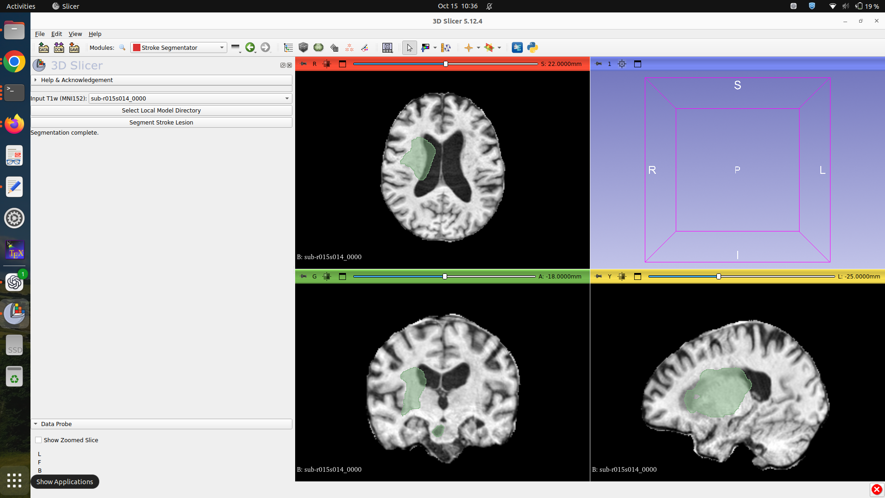

# SlicerStrokeSegmentator

SlicerStrokeSegmentator is a 3D Slicer extension for automated chronic ischemic stroke lesion segmentation from T1-weighted brain MRI using nnU-Net v2.

The extension performs local inference using a five-fold ensemble of pretrained models and displays predicted lesion segmentations directly in 3D Slicer.

## Features

- Automated chronic ischemic stroke lesion segmentation.
- T1-weighted brain MRI input.
- Five-fold nnU-Net v2 ensemble.
- Local pretrained model directory selection.
- Automatic verification of model checkpoints.
- Model directory saved between Slicer sessions.
- Segmentation results displayed directly in 3D Slicer.
- CPU-based inference.

## Requirements

- 3D Slicer (tested with version 5.12.4 on Linux).
- Compatible nnU-Net v2 installation in Slicer's Python environment.
- T1-weighted MRI registered to MNI152 1 mm isotropic space.
- Pretrained model weights obtained separately from the authors.
- Sufficient RAM and disk space for inference.

The extension currently uses CPU inference. Processing time depends on the computer hardware and input data.

## Installation

The extension can be loaded into 3D Slicer from its source directory.

1. Download or clone this repository.
2. Open 3D Slicer.
3. Load the SlicerStrokeSegmentator scripted module.
4. Open the Stroke Segmentator module under Segmentation.
5. Obtain the pretrained model weights from the authors.
6. Extract the weights into a local directory.
7. Click "Select Local Model Directory".
8. Select the nnU-Net results root directory containing Dataset001_StrokeT1w.

The extension uses ~/stroke_model as its default model directory.

Installation through the Slicer Extension Manager is subject to acceptance into the Slicer ExtensionsIndex.

## Model Directory Structure

The expected directory structure is:

    stroke_model/
      Dataset001_StrokeT1w/
        nnUNetTrainerImprovedLossCheckpoints__nnUNetPlans__3d_fullres/
          dataset.json
          plans.json
          fold_0/
            checkpoint_final.pth
          fold_1/
            checkpoint_final.pth
          fold_2/
            checkpoint_final.pth
          fold_3/
            checkpoint_final.pth
          fold_4/
            checkpoint_final.pth

Select the stroke_model directory, not an individual trainer or fold directory.

## Usage

1. Open the Stroke Segmentator module.
2. Load a T1-weighted MRI registered to MNI152 1 mm space.
3. Select the MRI in the Input T1w selector.
4. Select the local pretrained model directory if needed.
5. Verify that all required model checkpoints are present.
6. Click "Segment Stroke Lesion".
7. Wait for inference to finish.
8. The predicted lesion segmentation will appear in the Slicer scene.

The extension uses the custom nnU-Net trainer:

    nnUNetTrainerImprovedLossCheckpoints

All five model folds are combined during prediction.

## Public Testing Dataset - ATLAS v3.0 (629 Cases)

A collection of 629 publicly available ATLAS v3.0 T1-weighted brain MRI scans and their corresponding ground-truth stroke lesion masks is provided for testing SlicerStrokeSegmentator.

The collection includes:

- 329 newly released ATLAS v3.0 cases.
- 300 cases from the former ATLAS v2.0 validation dataset.

These 629 cases were not included in the original 655-case ATLAS v2.0 training dataset used to develop the segmentation model.

The images have been registered to MNI152 space for use with the segmentation pipeline. Users should verify that voxel spacing, image geometry, and preprocessing are compatible with the model.

### Dataset Download

[Download ATLAS v3.0 - 629 Cases (Google Drive)](https://drive.google.com/drive/folders/1kgHygdB5PSDqj0ScFCj-nxuHOd5gPvXk?usp=sharing)

The dataset is organised into two folders:

    ATLAS_v3.0/
      input/
        T1-weighted MRI scans
      masks/
        Ground-truth stroke lesion masks

The input folder contains the MRI scans, while the masks folder contains their corresponding reference lesion segmentations.

### Testing Procedure

1. Download a T1-weighted MRI from the input folder.
2. Open 3D Slicer and select the Stroke Segmentator module.
3. Load the MRI into Slicer.
4. Select the pretrained model directory.
5. Click "Segment Stroke Lesion".
6. Wait until segmentation is complete.
7. Load the corresponding ground-truth lesion mask from the masks folder.
8. Compare the predicted segmentation with the reference mask.

Suggested evaluation metrics include:

- Dice similarity coefficient (DSC).
- Lesion-wise precision, recall, and F1-score.
- Hausdorff distance (HD95).
- Lesion volume difference.
- Segmentation failure rate.

These metrics require a separate evaluation procedure and are not automatically calculated by the extension.

### Original Dataset Sources

ATLAS dataset download portal:
https://fcon_1000.projects.nitrc.org/indi/retro/atlas_download.html

ISLES'26 dataset information:
https://isles-26.grand-challenge.org/dataset/

The official ISLES'26 challenge evaluates algorithms using native-space MRI. The MNI152-registered testing collection described here is intended for testing this extension and is not an official ISLES'26 submission.

Users must comply with the original dataset's applicable access, attribution, and redistribution conditions.

## Model Access

Pretrained model weights are not included in this repository.

The associated research manuscript is currently under preparation. Model weights may be provided to authorised researchers upon request, subject to applicable access conditions.

Contact:

- pahm409@aucklanduni.ac.nz
- parvezamu@gmail.com

The repository will be updated with information about model availability following publication arrangements.

## Research and Clinical Use

This software is intended for research purposes only.

It is not established as a clinically validated diagnostic tool and should not be used independently for clinical diagnosis, treatment decisions, or patient management.

Segmentation accuracy may vary depending on MRI acquisition, preprocessing, registration quality, lesion characteristics, and differences between training and evaluation datasets.

## Citation

Ahmad et al. Manuscript in preparation.

Auckland Bioengineering Institute,
University of Auckland,
New Zealand.

Please cite the associated publication when it becomes available and acknowledge the original ATLAS dataset publications when using the testing data.

## Acknowledgements

HRC grant 21/144 IMPRESS.

## License

The extension source code is released under the Apache License, Version 2.0.

See LICENSE.txt for the complete licence terms.

Pretrained model weights are distributed separately and may have different access and licensing conditions.
